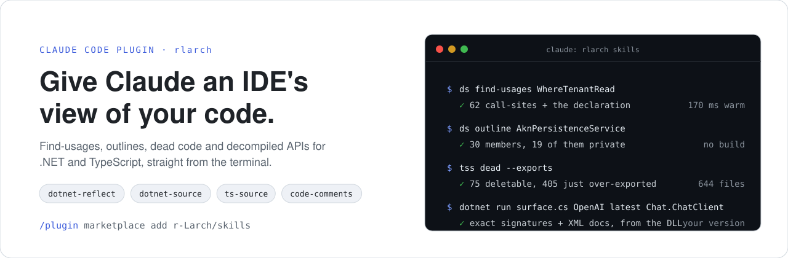
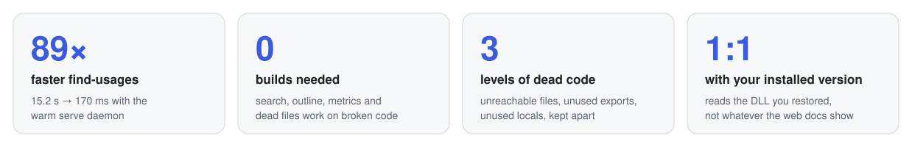

<p align="center">
  <picture>
    <source media="(prefers-color-scheme: dark)" srcset=".github/assets/hero-dark.svg">
    
  </picture>
</p>

<p align="center">
  <a href="#install"><b>Install</b></a> ·
  <a href="#what-you-get"><b>What you get</b></a> ·
  <a href="#why-not-just-let-claude-grep"><b>Why</b></a> ·
  <a href="#looking-for-orchestrate-controller-or-nested-claude"><b>Looking for orchestrate?</b></a> ·
  <a href="CHANGELOG.md"><b>Changelog</b></a>
</p>

**rlarch** is a [Claude Code](https://code.claude.com) plugin that answers the questions an IDE
answers: *who uses this, what's inside this class, what can I delete, what's the exact signature in
the version I actually have.* It answers them in milliseconds, from the terminal, even on code that
doesn't compile.

## Install

```
/plugin marketplace add r-Larch/skills
/plugin install rlarch@rlarch
```

Restart Claude Code and you're done. **There are no commands to learn:** each skill loads itself when
what you ask matches it. Works on Windows, macOS and Linux.

## What you get

<table>
<tr>
<td width="50%" valign="top">

🔎 **[`dotnet-source`](#dotnet-source)**

**Navigate the .NET code you're editing.** Find-usages, outlines, call trees and dead code, with
private members included. It works mid-refactor, when the solution doesn't build.

💬 *"Who calls `WhereTenantRead`?"*<br>
💬 *"Outline this god-class."*

⚙️ Needs the .NET 10 SDK

</td>
<td width="50%" valign="top">

🧭 **[`ts-source`](#ts-source)**

**The same for TypeScript and JavaScript.** JSX-aware find-usages, the import graph, and dead code
that tells *delete this* apart from *just drop the `export`*.

💬 *"What can I delete in this frontend?"*<br>
💬 *"Where is `<Badge/>` used?"*

⚙️ Needs Node 18+

</td>
</tr>
<tr>
<td width="50%" valign="top">

📦 **[`dotnet-reflect`](#dotnet-reflect)**

**Know the real API of a NuGet package you don't own.** Exact signatures with XML docs, decompiled
method bodies and version diffs, read from the DLL you actually restored.

💬 *"What's the signature of `ChatClient.CompleteChatAsync`?"*<br>
💬 *"What changed between 2.11 and 2.12?"*

⚙️ Needs the .NET 10 SDK

</td>
<td width="50%" valign="top">

✂️ **[`code-comments`](#code-comments)**

**Cut comment noise down to what matters.** Deletes narration, stale notes and docs that only restate
a signature, and keeps the few comments the code can't say for itself.

💬 *"Clean up the comments in this folder."*

⚙️ Needs nothing else

</td>
</tr>
</table>

<details>
<summary>Install from your terminal instead</summary>

```bash
claude plugin marketplace add r-Larch/skills
claude plugin install rlarch@rlarch
claude plugin details rlarch     # should list four skills
```

On Windows the launchers want PowerShell 7+ (`ts-source` also runs on Windows PowerShell); on
macOS/Linux they're plain `bash`.

</details>

## Why not just let Claude grep?

Claude Code is great at reading code it can see, and weak at finding the rest. Ask it who calls a
method in a 1,000-file solution and it greps, misses the overrides, and burns context on false hits.
Ask it how a NuGet API works and it guesses from whatever version it was trained on.

<p align="center">
  <picture>
    <source media="(prefers-color-scheme: dark)" srcset=".github/assets/stats-dark.svg">
    
  </picture>
</p>

- **Semantic, not textual.** Roslyn and the TypeScript compiler bind every reference, so overrides,
  declarations and `<Component/>` usages count and same-named strangers don't.
- **Fast enough to use constantly.** On-disk parse indexes make warm queries ~100–250 ms; an opt-in
  daemon keeps the full compilation resident for the semantic queries.
- **No improvised tooling.** Without these skills, an agent writes one-off scripts to answer such
  questions, like ~40 lines of reflection code per NuGet lookup, and often needs several tries. A
  tested command it can call saves those tokens and keeps it on the task.
- **Small output, small context.** Each command prints a dense digest, not a file dump, so Claude
  spends its context on your problem.
- **Safe.** Nothing executes your code. The compilers only ever parse and bind it, and `dotnet-reflect`
  loads assemblies metadata-only.

## Looking for `orchestrate`, `controller` or `nested-claude`?

<p>
  <a href="https://github.com/getsupraman/workman">
    <picture>
      <source media="(prefers-color-scheme: dark)" srcset=".github/assets/workman-lockup-on-dark.svg">
      
    </picture>
  </a>
</p>

**The planning and agent skills grew up and moved out.** Since rlarch 3.0 they ship in
**[Workman](https://github.com/getsupraman/workman)**, part of the [Supraman](https://supraman.ai)
suite: *run your crew of AI coding agents like a shift. Workman keeps the record of what they did.*

**One Workman for every machine and every co-worker.** Your Claude Code sessions on the laptop, the
desktop and a teammate's machine all write to one shared record. Plans, tasks, findings and the
evidence for each one go there over MCP, instead of into markdown files that go stale. One dashboard
shows the whole team's runs, and work hands over between people and machines without anything getting
lost.

`/workman:plan` turns a request into a run with done-criteria and verify commands, and
`/workman:controller` and `/workman:orchestrate` execute it. A task only closes when its criteria are
checked and a verification was actually run.

**Get started on [work.supraman.ai](https://work.supraman.ai)**, the hosted Workman: dashboard and
MCP endpoint in one place. Install the skills, then connect:

```
/plugin marketplace add getsupraman/workman
/plugin install workman@supraman
```

```bash
claude mcp add --transport http --scope user workman https://work.supraman.ai/mcp
```

Claude Code opens a browser sign-in on first use, so you never paste a token. Access is by
invitation today. **Coming:** sign up yourself, invite your team, and a free plan alongside paid
plans.

Prefer to run it yourself? `/workman:setup` starts Workman locally in Docker.

<details>
<summary><b>Where each rlarch 2.x skill went</b></summary>

| rlarch 2.x | Workman |
|---|---|
| `/rlarch:workstate` | `/workman:plan` |
| `/rlarch:workstate-setup` | `/workman:setup` |
| `/rlarch:workstate-import` | `/workman:import` |
| `/rlarch:controller` | `/workman:controller` |
| `/rlarch:orchestrate` | `/workman:orchestrate` |
| `/rlarch:nested-claude` | `/workman:agents` (tools `mcp__plugin_workman_agents__*`) |

Your Workman server and its data stay exactly where they are; only the skills changed plugins.
Step-by-step: **[upgrade_guide.md](upgrade_guide.md#upgrading-from-2x-to-30)**.

</details>

The two plugins sit side by side: rlarch helps an agent *understand* the code; Workman helps you
*run* agents and trust what they report.

---

## `dotnet-reflect`

Inspects the API surface of any .NET **NuGet package or assembly** — read straight from the DLL on
disk, so it's exact for the version you actually have, not whatever version the web docs happen to
show.

It answers the questions you hit when using an unfamiliar package: *what's this type called, what's
the real signature, which overload, is this nullable, what changed between versions, who calls this,
what does this method actually do?*

> **Why it exists.** Without it, every time a coding agent needed to look inside a NuGet package it
> wrote ~40 lines of throwaway reflection code: find the DLL, resolve its dependencies, load it,
> dump the members. It usually took several attempts before that code ran. Each lookup cost tokens
> and pulled the agent's attention off the actual task. A working script it can just call turns that
> detour into one command, and the agent's focus stays on your problem.

### What it does

Seven one-command scripts. Each takes a **package id + version** (or a `--bin` folder) and builds
everything it needs itself (no DLL/dependency/XML hunting):

| Command | Answers |
|---|---|
| `find` | "what is it called / where does it live" — locate types & members by name |
| `find-usages` | "who calls this / where is it used" — reverse usages, read from compiled IL, with file:line |
| `surface` | exact signatures + XML-doc summaries (the default digest) |
| `decompile` | real C# **with method bodies** — the behavior signatures can't show |
| `diff` | API changelog between two versions (added/removed types & members) |
| `cache` | where a package lives in the local NuGet cache, its versions & files |
| `bindir` | build a reusable workbench bin folder and print its path |

Signatures are **metadata-accurate**: nullable value **and** reference types (`HttpStatusCode?`,
`string?`, `Func<HttpContext,String?>?`), `required` members, `[SetsRequiredMembers]`, `[Obsolete]`,
`static`/`virtual`/`override`, and a C#-style header with directly-declared interfaces
(`class X : Base, IFoo`). Metapackages (e.g. `OpenIddict.AspNetCore`) expand to the real assemblies
they expose.

### Requirements

The **.NET 10 SDK** (`dotnet --version` ≥ 10) on the machine — the scripts are file-based C# apps.
Works on Windows, macOS, and Linux.

Claude invokes the skill automatically when you're working with an unfamiliar .NET package. You can
also drive the scripts directly:

```bash
# from the plugin's scripts directory ($CLAUDE_PLUGIN_ROOT/skills/dotnet-reflect/scripts)
dotnet run find.cs        OpenAI 2.12.0 Streaming
dotnet run surface.cs     OpenAI 2.12.0 Chat.ChatClient
dotnet run decompile.cs   OpenAI 2.12.0 OpenAI.Chat.ChatClient
dotnet run diff.cs        OpenAI 2.11.0 2.12.0
dotnet run find-usages.cs --bin MyApp/bin/Debug/net10.0 --only MyApp IsDevelopment
```

`version` may be the literal `latest`. Use `surface.cs --inherited` to also list base-type members.
`find-usages.cs` reads compiled IL — point `--bin` at your built solution output; a portable PDB adds
`file:line` and the source line.

### How it works

- **Load-only reflection** (`System.Reflection.MetadataLoadContext`) reads metadata without executing
  the package; the shared-framework directories are added to the resolver so web/framework base types
  resolve.
- **In-process decompilation** (`ICSharpCode.Decompiler`) — no global tools required.
- The **workbench** is a throwaway project built once per (package, version) under your temp dir and
  reused, so repeated queries are fast.

### Private / authenticated feeds

Packages on a private feed (e.g. GitHub Packages) work via your `nuget.config`. Point the scripts at
it with the `NUGET_API_CONFIG` env var (or run from inside a repo that has one); credentials
referenced as `%ENV_VAR%` expand from the environment at restore time. See the skill's `SKILL.md` for
details.

---

## `dotnet-source`

ReSharper-class navigation for the **solution you're editing**, from the terminal. It parses your
`.cs` with **Roslyn**, which buys the two things a metadata reader structurally cannot give you:
it **works on a solution that doesn't compile**, and it **sees `private`/`internal` members** — the
guts of the god-class you're actually untangling.

### What it does

| Command | Answers |
|---|---|
| `search` | "what's it called" — by name **and kind**, with signatures |
| `outline` | a type's full member list — **private included**, partial parts merged |
| `tree` | project → namespace → type map |
| `metrics` | rank types by size — **god-class detection** |
| `find-usages` | "who uses this" — call-sites **and** declarations/locals/overrides |
| `impls` | who implements this interface / derives from this base |
| `calls` | call hierarchy (`--callers` / `--callees`) |
| `unused` | declared but never referenced |
| `serve` | keep the Roslyn compilation warm (see below) |
| `discover` | what the tool actually sees — start here if a count looks wrong |

**Tier 1** (`search`/`outline`/`tree`/`metrics`) needs **no build at all**.
**Tier 2** (the semantic four) needs a `dotnet restore` — still **not** a build.

From `$CLAUDE_PLUGIN_ROOT/skills/dotnet-source`, with the launcher for your OS:

```powershell
# Windows — pwsh 7+
./ds.ps1 metrics --sort methods --top 20      # find the god-classes
./ds.ps1 outline AknPersistenceService        # 30 members — 19 of them private
./ds.ps1 find-usages WhereTenantRead          # 62 call-sites + the declaration
./ds.ps1 impls ITenantContext
./ds.ps1 discover --semantic                  # project set + reference health
```

```bash
# macOS / Linux — bash
bash ./ds.sh metrics --sort methods --top 20
bash ./ds.sh outline AknPersistenceService
bash ./ds.sh find-usages WhereTenantRead
bash ./ds.sh impls ITenantContext
bash ./ds.sh discover --semantic
```

### Keeping the compilation alive

The tool is **one compiled binary**, not a file-based script: it's built once into a hash-keyed
cache (keyed on sources + pinned Roslyn versions + runtime band) and reused at **~100 ms startup**.
On top of that, two layers keep work alive between calls:

- **Tier 1** — an on-disk parse index keyed by `path + mtime + size`; only changed files re-parse.
- **Tier 2** — can't use an index (it needs live syntax trees and a `Compilation`), so there's an
  opt-in daemon:

```
find-usages on a 21-project / 1086-file solution:   stateless 15,200 ms  →  `ds serve` 170 ms
```

`serve` is opt-in — commands use it if it's running and fall back to stateless if not; they never
spawn one for you. A file watcher applies your edits incrementally.

### How it works

- **Roslyn**, no MSBuild. The `Solution` is assembled in memory: the `.slnx`/`.sln` gives the
  authoritative project set, references come from each project's `obj/project.assets.json` plus the
  shared frameworks, and `<ProjectReference>` edges are wired transitively.
- **Never from `bin/`** — a project's own output dll would declare every one of its types a second
  time and make symbols ambiguous. `assets.json` needs only a restore, never a compile.
- Nothing executes your code; Roslyn only parses and binds it.

Validated against `dotnet-reflect` on a real solution: both tools independently find the **same 62
call-sites** for a symbol, and `dotnet-source` additionally reports the declaration that IL can't see.

The design notes behind the tool live in [`docs/dotnet-source-design.md`](docs/dotnet-source-design.md).

---

## `ts-source`

`dotnet-source`'s twin for the **TypeScript/JavaScript project you're editing**. It parses your
`.ts`/`.tsx`/`.js`/`.jsx` with the **TypeScript compiler API**, so it works on a project that
doesn't compile, sees declarations that aren't exported, and — unlike grep — knows that `<Badge/>`
in JSX is a reference to `Badge` while `BadgeProps` is not.

Built for Vite + SolidJS/React apps and pnpm/npm workspaces.

### What it does

| Command | Answers |
|---|---|
| `search` | "what's it called" — by name **and kind** (`component`, `hook`, `primitive`, `type`, …) |
| `outline` | a declaration's members, or a whole file in line order — **non-exported included** |
| `tree` | directory → files / declarations / exports / lines |
| `metrics` | rank files or types by size — **god-file detection** |
| `graph` | the import graph for one module: who pulls it in, and which names they take |
| `dead` | **three levels of dead code** — see below |
| `find-usages` | "who uses this" — JSX usage, imports, call sites, the declaration |
| `impls` | who implements this interface / extends this class |
| `calls` | call hierarchy (`--callers` / `--callees`) |
| `serve` | keep the LanguageService warm (see below) |
| `discover` | what the tool actually sees — start here if a count looks wrong |

**Tier 1** (`search`/`outline`/`tree`/`metrics`/`graph`/`dead`) needs **no build and no typecheck**.
**Tier 2** (`find-usages`/`impls`/`calls`) needs `node_modules` installed — still **not** a build.

From `$CLAUDE_PLUGIN_ROOT/skills/ts-source`, with the launcher for your OS:

```powershell
# Windows — pwsh or Windows PowerShell
./tss.ps1 metrics --sort loc --top 20         # find the files that got out of hand
./tss.ps1 outline --file src/utils/http.ts    # 42 declarations, most of them not exported
./tss.ps1 find-usages Badge                   # 106 JSX usages + 25 imports + the declaration
./tss.ps1 graph src/utils/http.ts --importers # blast radius of a change
./tss.ps1 dead                                # what can I delete?
```

```bash
# macOS / Linux — bash
bash ./tss.sh metrics --sort loc --top 20
bash ./tss.sh outline --file src/utils/http.ts
bash ./tss.sh find-usages Badge
bash ./tss.sh graph src/utils/http.ts --importers
bash ./tss.sh dead
```

### Dead code, in three levels

The reason this skill exists. An ES-module codebase can answer a strictly stronger question than a
.NET solution can: not "does any reference exist" but **"is this reachable from an entry point"** —
from syntax alone, no program build. So `dead` is seconds, not minutes.

| Level | Question | Confidence |
|---|---|---|
| `--files` | no entry point reaches this module | highest — also catches **transitively dead** clusters |
| `--exports` | no other module imports this name | high — split into **deletable** vs **over-exported** |
| `--locals` | declared in a file, never read there | exact, but needs a Program (slower) |

That `--exports` split is the part most tools get wrong. "Nobody imports this" covers both a function
you can delete and a helper that is merely exported for no reason, and they need opposite actions.
On a real 644-file SolidJS app: **75 deletable, 405 just over-exported** — drop the `export` keyword,
don't delete the code.

The safety rails matter as much as the findings, because people act on this output by deleting
files. With **no entry points found** the command **refuses to run** rather than declare the whole
project dead; if **>35% of files** come back unreachable it warns that you are almost certainly
missing an entry point; `import * as ns` and bare dynamic imports make a module's exports all-live;
Solid `use:` directives are never reported; and barrels are **charged through**, so
`export * from './PagedList'` does not make `PagedList` look used.

### Keeping the compilation alive

- **Tier 1** — an on-disk parse index keyed by `path + mtime + size`; only changed files re-parse.
  One parse yields both the declarations and the import edges, so nothing pays twice.
- **Tier 2** — a `LanguageService` can't be serialised, so there's an opt-in daemon:

```
on a 644-file SolidJS app:   find-usages   stateless 4,612 ms  →  `tss serve` 391 ms
                             impls         stateless 4,958 ms  →  `tss serve` 153 ms
```

`serve` is opt-in and returns once warm — same contract as `ds serve`, same herd-avoidance.

### How it works

- **No build step and no install.** The tool is plain ES modules with `// @ts-check` JSDoc types, run
  directly by Node — nothing to compile, nothing to cache-invalidate, ~150 ms cold start.
- **It analyses with the project's own TypeScript**, resolved from `node_modules`. This is the
  opposite of `dotnet-source`'s pinned-Roslyn rule and lands there for the same reason: an older
  parser turns newer syntax into error nodes and silently drops declarations, and in the npm world
  it's the project — not the tool — that decides how new the syntax is. Using its compiler makes
  that self-pinning. A project with no TypeScript gets a pinned copy installed into the cache once.
- **The `tsconfig.json` is authoritative for the file set**, the way the `.slnx` is for
  `dotnet-source` — a naive `**/*.ts` glob would ingest `node_modules`, `dist` and every worktree
  copy and quietly corrupt every count.
- Nothing executes your code; the compiler API only ever parses and binds it.

---

## `code-comments`

A subtractive pass over the comments in a file, folder or project. **The default verdict on every
comment is DELETE.** A comment survives only when it states a present-tense constraint the code can't
state itself, usually an invariant imposed from another file, and then it points at that file instead
of paraphrasing it.

What goes: comments that restate the next line, *"used to…"* changelog narration left behind by a
refactor, JSDoc and XML docs that repeat a signature, and anything stale or wrong. Existing comments are
treated as untrusted, so a stale one is deleted, not corrected. Survivors are budgeted to one line.

Doctrine is language-agnostic, with worked mechanics for C#/.NET (including the CS1587 trap on record
positional parameters) and TypeScript/JavaScript. It never changes behaviour and never writes new
documentation.

---

## On names

Typed as slash commands, plugin skills are namespaced: `/rlarch:dotnet-reflect`,
`/rlarch:dotnet-source`, `/rlarch:ts-source`, `/rlarch:code-comments`. You rarely need to type them,
because automatic invocation ignores the prefix. The namespace can't be turned off.

## Upgrading

- **From rlarch 2.x** (you used orchestrate, controller, workstate or nested-claude): see
  [Looking for orchestrate?](#looking-for-orchestrate-controller-or-nested-claude) and the
  [upgrade guide](upgrade_guide.md#upgrading-from-2x-to-30).
- **You still have `dotnet-reflect@rlarch` or `dotnet-source@rlarch`** as separate plugins: follow
  [the two-minute migration](upgrade_guide.md#upgrading-to-the-single-rlarch-plugin). It has one
  scope trap worth reading first.

What changed in each version is in **[CHANGELOG.md](CHANGELOG.md)**.

## Repository layout

```
.claude-plugin/marketplace.json     # marketplace "rlarch": one plugin entry
plugins/rlarch/
  .claude-plugin/plugin.json        # the plugin, carries `version`
  skills/dotnet-reflect/            # SKILL.md + file-based C# scripts
  skills/dotnet-source/             # SKILL.md + ds.ps1/ds.sh + tool/ (net10.0 + Roslyn)
  skills/ts-source/                 # SKILL.md + tss.ps1/tss.sh + tool/ (plain ES modules)
  skills/code-comments/             # SKILL.md
docs/dotnet-source-design.md        # why dotnet-source is shaped the way it is
tests/dotnet-source/                # macOS/Linux daemon gate
.github/assets/                     # the images on this page
```

## Contributing

Issues and pull requests are welcome at **[github.com/r-Larch/skills](https://github.com/r-Larch/skills/issues)**.
Before changing anything, read **[AGENTS.md](AGENTS.md)**. The rule people trip over: a change only
reaches installed users if `version` in `plugins/rlarch/.claude-plugin/plugin.json` moves with it.

## License

[MIT](LICENSE) © René Larch. The Workman marks are part of the Supraman brand kit and are used here to
point at that project; they are not covered by this repository's license.
